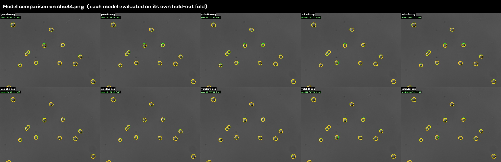
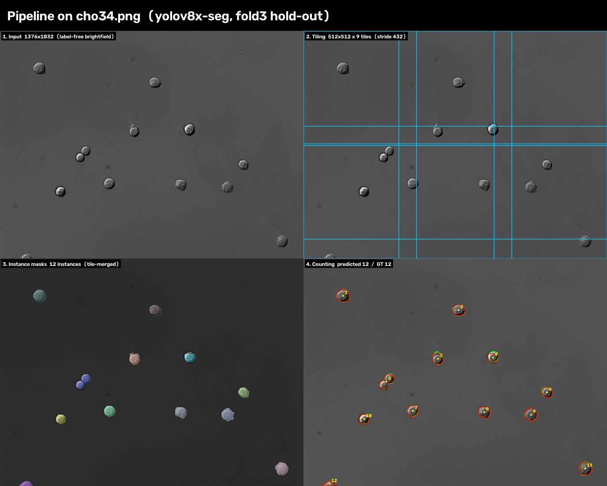

# CHO Cell Counting Optimization for BioSEM Research

무염색(label-free) 명시야 CHO 세포 이미지에 대한 **YOLOv8 / YOLOv11 세그멘테이션 및
세포 계수** 파이프라인. 10종 모델을 동일 조건으로 비교하고, 중첩 5-fold 교차검증으로
계수정확도 97% 목표를 검증했음.

참고 논문: G. Park, J. Park, S. Lee, *"Optimal Cell Segmentation and Counting Strategy
for Embedding in Low-Power AIoT Devices"*, Appl. Sci. 2026, 16, 357.
(본 저장소는 해당 논문의 CHO 검증 데이터셋에 YOLO 계열을 적용한 후속 작업)

참고 논문 저장소: https://github.com/SungjinDavidLee/Cell-Segmentation-and-Counting

사용 데이터셋: https://bbbc.broadinstitute.org/BBBC030 

---

## 핵심 결과

| 항목 | 값 | 측정 조건 |
|---|---|---|
| 계수정확도 (단독 모델 최고) | **0.9756 ± 0.0091** | yolov8x-seg, 중첩 5-fold CV |
| 계수정확도 (최소 모델) | **0.9716 ± 0.0055** | yolo11n-seg (2.8 M), 동일 |
| 계수정확도 (앙상블 최고) | **0.9768 ± 0.0063** | yolo11s+yolov8n+yolov8x, vote=3 |
| Dice | 0.9429 ~ 0.9506 | 10종 범위 |
| 인스턴스 F1 @IoU0.5 | 0.9584 ~ 0.9801 | 10종 + 앙상블 범위 |
| R² (예측 vs 실측 세포 수) | 0.938 | 60장 전수 |

계수정확도 정의는 참고 논문과 동일: `Acc = 1 − MAE / mean(N_GT)`

논문 CHO 결과(Dice 최고 93.1 / 계수 0.91~0.96) 대비 **Dice +2.0 %p, 계수 +1.7 %p**.

---

## 데이터셋 특성 (전수 실측)

| 항목 | 값 |
|---|---|
| 영상 수 | 60 장 (cho01~cho60.png) |
| 해상도 | 1376 × 1032, PNG, R=G=B (실질 8-bit 그레이스케일) |
| 총 세포 수 | 743 개 |
| 장당 세포 수 | 6 ~ 22 (중간값 12) |
| 세포 등가직경 | p5 41.5 / 중간값 **53.8** / p95 72.7 px |
| 전경 비율 | 1.08 ~ 4.14 % (평균 2.14 %) |
| 세포–배경 콘트라스트 | 약 6 계조 → 무염색 저콘트라스트 명시야 |
| 접촉·겹침 세포 | **0 건** |

---

## 단독 모델 성능표

모든 모델 동일 조건: fold 분할 / 300 epoch / patience 80 / 동일 증강 / 유효배치 16 /
imgsz 512 / AdamW lr0 1e-3 cosine.

**10종 전부 중첩 5-fold 교차검증 완료** — 세포 743개 전부가 홀드아웃에 포함되고,
후처리 conf 도 평가 fold 를 보지 않고 선택했으므로 완전 홀드아웃이며 **동일 조건에서
직접 비교 가능**함.

> 참고: 초기 fold0 단일 스크리닝 값은 체계적으로 낙관적이었음.
> 실측 격차 yolo11s-seg 스크리닝 0.9806 vs 교차검증 0.9690 (**1.2 %p**).

계수정확도는 nested 기준이며 ± 는 fold 간 표준편차임.

| 모델 | 파라미터 | ckpt | 계수정확도 | Dice | mIoU | instF1 | MAE | conf |
|---|---:|---:|---|---:|---:|---:|---:|---:|
| yolov8n-seg | 3.3 M | 6.8 MB | 0.9691 ± 0.0081 | 0.9470 | 0.9488 | 0.9704 | 0.383 | 0.55 |
| yolov8s-seg | 11.8 M | 23.9 MB | 0.9584 ± 0.0122 | 0.9448 | 0.9469 | 0.9609 | 0.517 | 0.65 |
| yolov8m-seg | 27.2 M | 54.8 MB | 0.9647 ± 0.0094 | 0.9438 | 0.9460 | 0.9650 | 0.433 | 0.65 |
| yolov8l-seg | 45.9 M | 92.3 MB | 0.9645 ± 0.0135 | 0.9449 | 0.9477 | 0.9680 | 0.433 | 0.65 |
| **yolov8x-seg** | 71.8 M | 144.0 MB | **0.9756 ± 0.0091** | 0.9450 | 0.9478 | 0.9680 | 0.300 | 0.65 |
| **yolo11n-seg** | **2.8 M** | 6.0 MB | **0.9716 ± 0.0055** | **0.9505** | **0.9520** | 0.9689 | 0.350 | 0.65 |
| yolo11s-seg | 10.1 M | 20.5 MB | 0.9690 ± 0.0052 | 0.9429 | 0.9457 | **0.9725** | 0.383 | 0.65 |
| yolo11m-seg | 22.4 M | 45.2 MB | 0.9658 ± 0.0084 | 0.9431 | 0.9457 | 0.9675 | 0.417 | 0.65 |
| yolo11l-seg | 27.6 M | 55.9 MB | 0.9671 ± 0.0140 | 0.9448 | 0.9476 | 0.9697 | 0.400 | 0.55 |
| yolo11x-seg | 62.1 M | 124.8 MB | 0.9608 ± 0.0069 | 0.9454 | 0.9474 | 0.9584 | 0.483 | 0.65 |

**97% 를 넘긴 단독 모델은 2종**: yolov8x-seg(0.9756, CI 하한 0.9700)와
yolo11n-seg(0.9716, CI 하한 0.9670). 나머지 8종은 0.9584~0.9691 로 미달함.

### 선택 방식별 비교 (10종)

| 모델 | fixed | **nested** | oracle | 95% CI (nested) |
|---|---:|---|---:|---|
| yolov8n-seg | 0.9719 | **0.9691 ± 0.0081** | 0.9770 | [0.9617, 0.9760] |
| yolov8s-seg | 0.9584 | **0.9584 ± 0.0122** | 0.9678 | [0.9479, 0.9687] |
| yolov8m-seg | 0.9551 | **0.9647 ± 0.0094** | 0.9673 | [0.9555, 0.9717] |
| yolov8l-seg | 0.9647 | **0.9645 ± 0.0135** | 0.9743 | [0.9533, 0.9763] |
| yolov8x-seg | 0.9756 | **0.9756 ± 0.0091** | 0.9769 | [0.9700, 0.9847] |
| yolo11n-seg | 0.9716 | **0.9716 ± 0.0055** | 0.9716 | [0.9670, 0.9759] |
| yolo11s-seg | 0.9635 | **0.9690 ± 0.0052** | 0.9703 | [0.9644, 0.9735] |
| yolo11m-seg | 0.9632 | **0.9658 ± 0.0084** | 0.9671 | [0.9584, 0.9732] |
| yolo11l-seg | 0.9615 | **0.9671 ± 0.0140** | 0.9686 | [0.9535, 0.9759] |
| yolo11x-seg | 0.9605 | **0.9608 ± 0.0069** | 0.9705 | [0.9561, 0.9675] |

- `fixed` — conf 를 fold0 에서 골라 전 fold 에 적용. fold0 에 과적합된 값이 다른 fold 에서
  나쁠 수 있음 (v8m conf=0.25 → 0.9551 로 하락).
- `nested` — fold k 의 conf 를 **k 를 제외한 4개 fold** 에서만 선택. ← **헤드라인 수치**
- `oracle` — 각 fold 자기 자신에서 선택. 낙관 편향, 상한으로만 참고.

편향 제거가 반드시 숫자를 낮추지는 않는다 (yolo11s: fixed 0.9635 → nested 0.9690).

### 모델 크기와 성능

**단조 관계가 아님.** 10종 전수 교차검증 결과, 파라미터 수와 계수정확도는
비례하지 않음.

| 구간 | 모델 | 계수정확도 |
|---|---|---|
| 최소 (2.8 M) | yolo11n-seg | **0.9716** ← 2위 |
| 최대 (71.8 M) | yolov8x-seg | **0.9756** ← 1위 |
| 중간 (11.8~62.1 M) | 나머지 8종 | 0.9584 ~ 0.9691 |

**최소 모델(2.8 M)이 중간 크기 8종을 모두 앞섬.** 세포가 크고(54 px) 희소하며
(장당 12개) 균일해 과제 난이도가 낮아, 용량을 키워도 이득이 없고 오히려
과적합 쪽으로 기우는 것으로 보임.

실용적 함의: **yolo11n-seg(6.0 MB)가 yolov8x-seg(144.0 MB)와 0.4 %p 차이**로
24배 작고 CPU 추론이 15배 빠름. 엣지 배포에는 yolo11n-seg 를 권장함.

지표별 승자도 상이: 계수 최고 yolov8x, Dice·mIoU 최고 yolo11n, instF1 최고 yolo11s.

---

## 추론 지연시간

입력 1장(1376×1032) → 512 타일 9개 일괄 추론. warmup 5회 후 20회 측정, 중간값.
**개발 머신(RTX 5090 / x86 CPU) 기준이며 엣지 실기 수치가 아님.**

| 모델 | ckpt | GPU FP32 | GPU FP16 | CPU FP32 |
|---|---:|---|---|---|
| yolo11n-seg | 6.0 MB | 7.5 ms (133.9 fps) | 6.6 ms (150.8 fps) | 75.3 ms (13.3 fps) |
| yolov8n-seg | 6.8 MB | 8.0 ms (124.4 fps) | 7.2 ms (139.2 fps) | 86.2 ms (11.6 fps) |
| yolo11s-seg | 20.5 MB | 9.7 ms (102.7 fps) | 7.9 ms (126.3 fps) | 194.4 ms (5.1 fps) |
| yolov8s-seg | 23.9 MB | 9.6 ms (104.3 fps) | 7.8 ms (128.7 fps) | 210.8 ms (4.7 fps) |
| yolo11m-seg | 45.2 MB | 17.7 ms (56.5 fps) | 11.8 ms (84.9 fps) | 562.7 ms (1.8 fps) |
| yolov8m-seg | 54.8 MB | 17.1 ms (58.7 fps) | 11.3 ms (88.3 fps) | 436.0 ms (2.3 fps) |
| yolo11l-seg | 55.9 MB | 20.6 ms (48.5 fps) | 13.9 ms (71.9 fps) | 668.9 ms (1.5 fps) |
| yolov8l-seg | 92.3 MB | 23.8 ms (42.1 fps) | 15.2 ms (65.8 fps) | 781.1 ms (1.3 fps) |
| yolo11x-seg | 124.8 MB | 35.4 ms (28.3 fps) | 21.5 ms (46.5 fps) | 1283.9 ms (0.8 fps) |
| yolov8x-seg | 144.0 MB | 39.4 ms (25.4 fps) | 21.3 ms (47.0 fps) | 1168.6 ms (0.9 fps) |

---

## 파이프라인

```
GT 윤곽선 PNG ─┐
               ├─ gt_fill.py        윤곽 채움 + 끊긴 윤곽 보정 → 인스턴스 라벨맵
원본 PNG ──────┘
                  build_ds.py       512 타일 / stride 432 → YOLO-seg 폴리곤, 파일단위 5-fold
                  train_yolo.py     동일 하이퍼파라미터로 10종 학습
                  evaluate.py       전체 영상 타일 추론 → 마스크 IoU 병합 → 원본 좌표계 평가
                  nested_cv.py      중첩 CV 집계 (fixed / nested / oracle)
                  stage3b.py        D4 TTA · 다중 모델 앙상블
```

### 재현 방법

```bash
pip install ultralytics opencv-python numpy matplotlib

# 1) GT 윤곽선 채우기 → 인스턴스 라벨맵
python code/prep_instances_filled.py

# 2) 5-fold 타일 데이터셋 생성
python code/build_ds.py

# 3) 10종 전수 학습 + 후처리 스윕 (fold0 스크리닝)
python code/stage1_screen.py

# 4) 상위 모델 5-fold 교차검증
python code/stage2_cv.py yolov8x-seg.pt yolo11s-seg.pt yolov8n-seg.pt

# 5) 중첩 CV 집계 / 앙상블 / 표 / 그림 / 보고서
python code/nested_cv.py
python code/stage3b.py ens3x
python code/single_table.py
python code/make_figures.py --lang en
python code/make_report.py
```

경로 상수는 `code/config.py` 에 모여 있음. 다른 위치에서 쓰려면 `CHO_ROOT` 를 지정:

```bash
export CHO_ROOT=/path/to/workspace   # $CHO_ROOT/dataset/{images,ground_truth} 기대
```

### 테스트

```bash
pytest -q tests/                  # 또는 pytest 없이
python tests/test_pipeline.py
```

13개 불변식을 검증 — 경로 이식성, 저장소/작업본 동기화, 전 모듈 import 가능 여부,
pyflakes 정적 검사,
타일 격자 기하, fold 분할 무결성, 성능표와 원시 JSON 의 일치, nested ≤ oracle,
지연시간 정합(FP16 ≤ FP32), GT 채움 결과(743 세포 / 53.8 px / 2.14 %),
GT 가 외곽선인지, calibration 세트 규격.

데이터가 없는 클론 직후에는 데이터 의존 테스트가 자동으로 skip 되고
이식성, 정적 검사만 돈다(8 passed, 3 skipped).

---

## 학습 가중치

파일 크기(최대 144 MB, 총 1.4 GB) 때문에 git 본문이 아니라 **GitHub Releases** 에 올렸음.

- 태그 `weights-v1` → [Releases](../../releases) 참고
- 명명 규칙 `<모델>_f<fold>.pt` (예: `yolov8x-seg_f0.pt`)
- A등급 4종은 fold 0~4 전부, B등급 6종은 fold 0 제공

### 모델 명세 (변환·배포용)

| 항목 | 값 |
|---|---|
| 프레임워크 | Ultralytics YOLO 8.4.150 / PyTorch 2.11.0+cu128 |
| 태스크 | instance segmentation (`task=segment`) |
| 입력 해상도 | **512 × 512** (타일 단위), RGB 3채널 uint8 |
| 원본 영상 | 1376 × 1032 → 512 타일 / stride 432 → 3×3 = 9 타일 |
| 클래스 수 | **1** |
| 클래스 목록 | `0: cell` |
| 정규화 | Ultralytics 내부 `/255.0` (별도 mean/std 없음) |
| 출력 | 박스 + 마스크 (`retina_masks=True` 로 원본 해상도 마스크) |
| 권장 conf | 모델별 상이, 위 표 `conf` 열 참조 (0.25 ~ 0.65) |
| NMS IoU | 0.5 |
| 후처리 | 타일 간 마스크 IoU 병합 (IoU ≥ 0.3 또는 포함비 ≥ 0.6 → 중복 제거) |

---

## 적용 예시 (segmentation / counting)

모든 예시는 **해당 영상을 학습에 쓰지 않은 fold 모델**로 추론한 결과임.
(학습에 쓴 모델로 그린 그림은 성능을 과대 표현하므로 사용하지 않음)

색상 규칙: 🟢 GT · 🟠 TP(매칭된 예측) · 🔴 FP(오검출) · 🟣 FN(미검출)

### 모델 비교 — 같은 영상, 10종 전부

세포 밀도 저/중/고 3장과, 실제로 오차가 발생한 2장을 함께 수록함.
성공 사례만 보이면 실제 성능을 오해하게 되므로 실패 사례를 같이 둠.

| 영상 | GT | 결과 |
|---|---:|---|
| `cho55` (저밀도) | 7 | [grid_cho55.jpg](figures/examples/grid_cho55.jpg) — 10종 중 9종 정확, yolo11m 만 +1 |
| `cho34` (중밀도) | 12 | [grid_cho34.jpg](figures/examples/grid_cho34.jpg) — **10종 전부 정확** |
| `cho51` (고밀도) | 20 | [grid_cho51.jpg](figures/examples/grid_cho51.jpg) — **10종 전부 정확** |
| `cho40` (오차 사례) | 18 | [grid_cho40.jpg](figures/examples/grid_cho40.jpg) — 10종 전부 +1~+3 과대계수 |
| `cho57` (최대 오차) | 15 | [grid_cho57.jpg](figures/examples/grid_cho57.jpg) — 10종 전부 FP 2~4 + FN 1 |



### 모델별 개별 결과

`figures/examples/per-model/<모델>_<영상>.jpg` — 10종 × 5영상 = 50장.
각 이미지에 GT/예측 개수와 TP·FP·FN 이 함께 표기됨.

5영상 합계 (GT 72 세포 기준):

| 모델 | 예측 합 | TP | FP | FN | 순오차 |
|---|---:|---:|---:|---:|---:|
| yolov8x-seg | 74 | 71 | 3 | 1 | +2 |
| yolo11x-seg | 75 | 71 | 4 | 1 | +3 |
| yolov8n-seg | 75 | 71 | 4 | 1 | +3 |
| yolov8s-seg | 75 | 71 | 4 | 1 | +3 |
| yolo11m-seg | 76 | 71 | 5 | 1 | +4 |
| yolo11s-seg | 76 | 71 | 5 | 1 | +4 |
| yolov8l-seg | 76 | 71 | 5 | 1 | +4 |
| yolov8m-seg | 76 | 71 | 5 | 1 | +4 |
| yolo11l-seg | 77 | 70 | 7 | 2 | +5 |
| yolo11n-seg | 77 | 71 | 6 | 1 | +5 |

> 이 5장은 오차 사례를 **의도적으로 포함**한 표본이므로, 전체 성능을 대표하지
> 않음. 교차검증 수치는 위 성능표를 볼 것.

### 파이프라인 단계별

[pipeline_cho34.jpg](figures/examples/pipeline_cho34.jpg) — 원본 → 512 타일 3×3
분할 → 인스턴스 마스크 → 계수(중심점 번호) 4단계.



### 오차 사례 확대

[errors_yolov8x-seg.jpg](figures/examples/errors_yolov8x-seg.jpg) — FP/FN 각 10건
을 확대한 크롭. FP 의 국소 텍스처가 실제 세포와 구분되지 않는 것을 육안으로
확인할 수 있음.

재생성: `python code/make_examples.py` → `python code/optimize_examples.py`

---


## 저장소 구조

| 경로 | 내용 |
|---|---|
| `code/` | 전처리·학습·평가·앙상블·그림·예시·보고서 스크립트 19개 |
| `docs/REPORT.txt` | 전체 분석 보고서 |
| `docs/SINGLE_MODEL_TABLE.txt` | 단독 모델 성능표 (원문) |
| `results/*.json` | 원시 측정 결과 (스윕 전조합, fold별 per-file 기록 포함) |
| `results/montage_*.png` | FP/FN 오차 사례 크롭 |
| `figures/en/` | 영문 그림 6종 |
| `figures/ko/` | 한글 그림 6종 |
| `figures/examples/` | 적용 예시 — 모델 비교 격자 5장, 개별 30장, 파이프라인, 오차 사례 |


## 라이선스

코드: MIT. 가중치는 Ultralytics 사전학습 모델에서 파인튜닝되었으므로
**AGPL-3.0** 제약을 따름 (상업적 활용 시 Ultralytics 라이선스 확인 필요).

## 인용

```
이성진 (Sungjin Lee), 순천향대학교 스마트자동차학과, sungjinlee@sch.ac.kr
```
